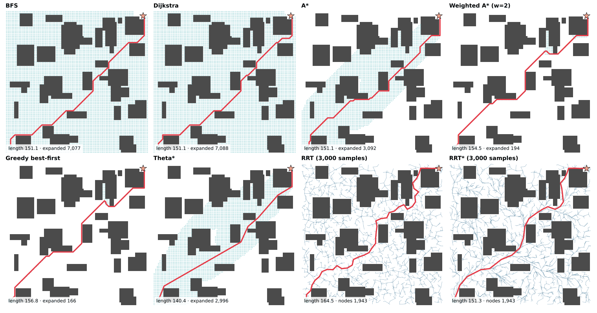
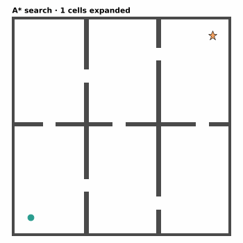
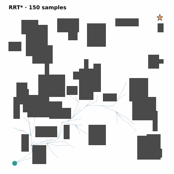
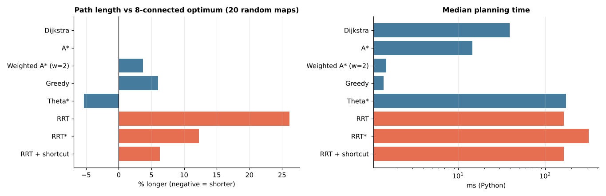
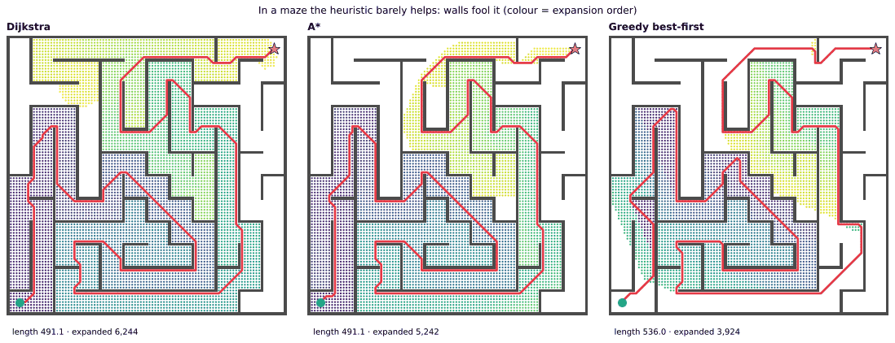

# 09 · Path planning: A*, Theta*, RRT, RRT*

Eight planners on the same maps, so you can **see** the trade-offs: graph search (BFS, Dijkstra, A*, weighted A*, greedy, Theta*) against sampling-based planners (RRT, RRT*, RRT + shortcutting), with a benchmark over 20 random maps. Pure Python and NumPy.



<p>


</p>

## Benchmark (20 random 100×100 maps)



| planner | success | length vs optimum | cells expanded / tree nodes | median time |
|---|---|---|---|---|
| Dijkstra | 20/20 | **1.000** | 7,117 | 39 ms |
| A* | 20/20 | **1.000** | 2,173 (3.3× fewer) | 15 ms |
| Weighted A* (w=2) | 20/20 | 1.037 | 197 | 1.5 ms |
| Greedy best-first | 20/20 | 1.060 | 167 | 1.4 ms |
| Theta* | 20/20 | **0.947** (any-angle beats the 8-connected grid) | 2,255 | 173 ms |
| RRT | 20/20 | 1.261 | 1,793 | 165 ms |
| RRT* | 20/20 | 1.123 | 1,793 | 317 ms |
| RRT + shortcut | 20/20 | 1.063 | 1,793 | 165 ms |

*Timings are pure Python on one CPU core. Compare them to each other, not to C++ planners.*

## What the pictures show

- **A* = Dijkstra + a heuristic.** It returns the same optimal path while expanding a narrow band towards the goal instead of a flood.
- **Weighted A* and greedy** trade path quality for speed: 10–20× fewer expansions, 4–6% longer paths. Weighted A* is guaranteed within w× of optimal (a test checks this).
- **Theta*** lets a node take its grandparent as parent when there's line of sight, so paths stop zig-zagging at 45° and come out **5% shorter** than the 8-connected optimum.
- **RRT** finds *a* path quickly but a jagged one. **RRT*** rewires its neighbourhood after every sample, so the path keeps improving as samples grow (the GIF). **Shortcutting** an RRT path is a cheap post-process that gets most of the way there.
- **Mazes break heuristics.** Walls fool the distance estimate, so A* barely beats Dijkstra, and greedy commits to dead ends:



## Implementation notes

- One best-first `search()` drives every graph planner. They differ only in priority (`g + w·h`, `h`, or `g`) and parent rule (Theta*'s line-of-sight). That makes the relationships between the algorithms obvious in code.
- 8-connected moves with **no corner cutting** past obstacles, and an **octile** heuristic (exact on an empty grid, so admissible and consistent).
- RRT* uses the shrinking radius `γ·√(log n / n)`, choose-best-parent, rewiring, and **cost propagation to descendants**. A test checks tree costs stay consistent with path length.
- `inflate()` grows obstacles by the robot radius, so planners can treat the robot as a point.

## Tests

`pytest` runs 25 tests in about 4 s across six maps (random, maze, rooms):
- A* cost equals Dijkstra's with no more expansions, and paths are valid 8-connected moves with no corner cutting
- weighted A* stays within w× of optimal, BFS has the fewest moves, and the octile heuristic is admissible and exact on an empty grid
- Theta* is never longer than A*, and every segment is collision-free
- unreachable goals and blocked starts fail cleanly; inflation geometry; maze connectivity
- RRT and RRT* paths are collision-free, RRT* beats RRT on the same samples, and its cost never increases as samples grow
- shortcutting shortens the path and keeps it valid

```bash
pip install -e ".[dev]"
pytest
python -m planning.viz     # benchmark + all figures and GIFs in docs/ (~1 min)
```

## What I learned

graph search · admissible and consistent heuristics · any-angle planning · sampling-based planning and asymptotic optimality · the speed/quality trade-off
